<div align="center">



<br/>


<br/><br/>

<a href="https://github.com/DivyomSrivastava"></a>
<a href="https://www.linkedin.com/in/divyom-srivastava-260b95342/"></a>
<a href="mailto:divyomsrivastava1109@gmail.com"></a>


</div>

<br/>


## 👋 &nbsp;About Me

I'm a **Computer Science undergraduate** focused on **Robotics, Artificial Intelligence, Computer Vision and Embedded Systems**. I like working where software meets hardware: ROS 2 simulations and controllers, vision pipelines, and the embedded devices that connect robots to the physical world.

My long-term goal is to build **real-world autonomous robotic systems** across the full stack, from sensors and microcontrollers to perception, planning and control, and across platforms: **ground, aerial and legged robots**. I'm starting with ground-robot navigation, robotic arms and automation, and expanding into **aerial vehicles and legged locomotion**.

```text
  Sensors ───▶ Perception ───▶ Estimation ───▶ Planning ───▶ Control ───▶ Actuation
  IMU · GNSS    OpenCV · YOLO   SLAM · Odometry  Nav2 · Paths  PID · ros2_control  Motors · Servos

  Platforms:   Ground robots   ·   Aerial vehicles   ·   Legged robots
```


## 🏆 &nbsp;Highlights

<div align="center">
<table>
<tr>
<td align="center" width="50%" valign="top">

### 🚀 TEKNOFEST 2026
**International Rocket Competition**<br/>
PDR ranked **6th globally** · **2nd in India**<br/>
<sub>Team PSIT VYOMNAUTS · Avionics & flight computer</sub>

</td>
<td align="center" width="50%" valign="top">

### 🧠 Robotics + AI
Projects combining<br/>
**ROS 2 · Computer Vision · Embedded · AI**<br/>
<sub>Focused on autonomous systems</sub>

</td>
</tr>
</table>
</div>


## 🤖 &nbsp;Featured Projects

<table>
<tr>
<th width="58%" align="left">Project</th>
<th width="42%" align="center">Preview</th>
</tr>

<tr>
<td width="58%" valign="top">

### 🛞 BumperBot
**ROS 2 differential-drive mobile robot**

Modeling, simulation and control of a mobile robot in the ROS 2 ecosystem. The robot is described in URDF/Xacro, simulated in Gazebo, driven through `ros2_control` with a `DiffDriveController`, and visualized in RViz, with TF2 transforms and odometry tying the system together.

* Differential-drive kinematics and odometry
* Joystick teleoperation
* Separate packages for description, control, messages, and C++ / Python examples

`ROS 2 Jazzy` `Gazebo` `RViz` `URDF/Xacro` `TF2` `ros2_control` `Python` `C++`

<a href="https://github.com/DivyomSrivastava/Bumper_Bot">View repository →</a>

</td>
<td width="42%" align="center" valign="middle">


</td>
</tr>

<tr>
<td width="58%" valign="top">

### 🦾 4-DOF Robotic Arm
**3D-printed arm with inverse kinematics and browser-based 3D control**

My first robotic arm, built end to end: 3D-printed structure, ESP32 + PCA9685 wiring, custom firmware and a web control studio. The firmware solves inverse kinematics on the board with reach, joint-limit and table-collision checks, and moves with minimum-jerk easing and per-joint speed limits. A Three.js page mirrors the same maths and drives the real arm over USB with the Web Serial API.

* Analytic IK: `XYZ 10 0 8` moves the tip to a point
* 8 built-in routines (wave, nod, dance, stretch and more)
* Drag a 3D target or follow the cursor from the browser
* Documented wiring, calibration and serial commands

`ESP32` `PCA9685` `Arduino C++` `Inverse Kinematics` `Three.js` `Web Serial` `CAD`

<a href="https://github.com/DivyomSrivastava/4DOF-Robotic-Arm">View repository →</a>

</td>
<td width="42%" align="center" valign="middle">


<br/>


</td>
</tr>

<tr>
<td width="58%" valign="top">

### 🚦 AI Traffic Monitoring
**Real-time vehicle detection & tracking**

Detects and tracks cars, motorcycles, buses and trucks in video to produce live traffic analytics. YOLOv8 handles detection, ByteTrack keeps identities across frames, and results are shown in a dashboard and exported as CSV reports.

* Multi-object tracking
* Vehicle counting
* Traffic density analysis
* Dashboard, statistics and CSV reporting

`YOLOv8` `OpenCV` `ByteTrack` `Python`

<a href="https://github.com/DivyomSrivastava/AI-Traffic-Monitoring-System">View repository →</a>

</td>
<td width="42%" align="center" valign="middle">


<br/>


</td>
</tr>

<tr>
<td width="58%" valign="top">

### 🧬 NeuroVision AI
**Brain tumor MRI classification with explainable AI**

Classifies MRI scans into Glioma, Meningioma, Pituitary or No Tumor with an EfficientNet-B0 model in PyTorch. Grad-CAM heatmaps show which regions drove each prediction, and a Streamlit app handles uploads, class probabilities and downloadable PDF reports.

* Single and batch analysis
* Grad-CAM visual explanations
* Class probability breakdown
* Automated PDF reporting

`PyTorch` `EfficientNet-B0` `Grad-CAM` `Streamlit`

<a href="https://github.com/DivyomSrivastava/Brain-Tumor-Detection-Deep-Learning">View repository →</a>

</td>
<td width="42%" align="center" valign="middle">


<br/>


</td>
</tr>
</table>

<br/>

### 🔐 AI Smart Security Rover
A robotics system that combines low-cost embedded hardware with a more capable ROS 2 compute stack.

```text
 ESP32-CAM ──▶ Video Stream ──▶ ROS 2 ──▶ Computer Vision / YOLO ──▶ Detection & Monitoring Dashboard
```


## 🚀 &nbsp;Rocketry & Avionics

### PSIT VYOMNAUTS · TEKNOFEST 2026

Part of the team for the **TEKNOFEST 2026 International Rocket Competition**: 🏆 **6th globally** in PDR and 🇮🇳 **2nd among Indian teams**.

<table>
<tr>
<td width="55%" valign="top">

**Avionics / Flight Computer**

* Raspberry Pi Pico 2
* BMP390 · DPS310 (barometric)
* BNO085 (IMU)
* NEO-M9N (GNSS)
* Sensor integration & flight-state estimation
* Telemetry & data logging

</td>
<td width="45%" valign="top">

**Rocket Parameters**

```text
Target Altitude : 3042 m
Lift-off Mass   : 22.886 kg
Motor           : M-1850-P
Flight Computer : Pico 2
```

</td>
</tr>
</table>

This work built my understanding of **embedded systems, sensors, telemetry, real-time data and engineering under competition constraints**.


## 🛠️ &nbsp;Tech Stack

<table>
<tr>
<td valign="top" width="20%">

**🤖 Robotics**<br/><br/>
<br/>
<br/>
<br/>
<br/>
<br/>
<br/>


</td>
<td valign="top" width="20%">

**💻 Programming**<br/><br/>
<br/>
<br/>
<br/>
<br/>
<br/>
<br/>
<br/>


</td>
<td valign="top" width="20%">

**👁️ AI & Vision**<br/><br/>
<br/>
<br/>
<br/>
<br/>
<br/>
<br/>
<br/>


</td>
<td valign="top" width="20%">

**🔌 Embedded**<br/><br/>
<br/>
<br/>
<br/>
<br/>
<br/>
<br/>
  

</td>
<td valign="top" width="20%">

**🧰 Tools**<br/><br/>
<br/>
<br/>
<br/>
<br/>
<br/>
<br/>
  

</td>
</tr>
</table>


## 🧭 &nbsp;Current Focus

```text
                         AUTONOMOUS ROBOTICS
                                 │
           ┌─────────────────────┼─────────────────────┐
           ▼                     ▼                     ▼
       Software              Perception             Hardware
    ROS 2 · TF2 · Nav2    OpenCV · YOLO · Cameras   ESP32 · STM32 · Pico
    Gazebo · RViz         Tracking · Detection      Sensors · Motors
           └─────────────────────┼─────────────────────┘
                                 ▼
                    Control · Estimation · Autonomy
```

### 📍 Roadmap

| Stage | Focus | Topics |
|:--|:--|:--|
| **🟢 Now** | Ground robots, manipulators, navigation & automation | Differential drive, arm kinematics (IK), servo control, odometry, TF2, ros2_control, Gazebo, Nav2, SLAM, localization, path planning |
| **🔵 Building** | Perception & embedded systems | OpenCV, YOLO, object tracking, sensor fusion, ESP32 / STM32 / Pico, UART · SPI · I²C, telemetry |
| **🟣 Next** | Aerial & legged locomotion | Flight dynamics, state estimation, flight control, multirotor and fixed-wing systems, gait generation, legged kinematics and balance control |

**Engineering foundation:** Python · C++ · Git · Linux · CMake


## 📊 &nbsp;GitHub Stats

<div align="center">


</div>

<br/>

<div align="center">

### 🤖 Building. Learning. Iterating.
*Turning software, sensors and intelligence into autonomous systems.*

<br/>

<a href="https://www.linkedin.com/in/divyom-srivastava-260b95342/"></a>


</div>
